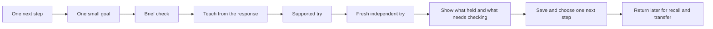

# Learning flow review

Flow proposal, 2026-10-12. In the follow-up chat, the owner liked the current student design and requested better challenge balance, delightful rewards, a parent redesign and separate student sign-in. The published follow-up preserves that student design, improves gap/review selection and Bloom instructions, adds earned cosmetic keepsakes, and implements the parent overview and restricted link/PIN access. See ../release/PARENT-STUDENT-FLOW.md. The deeper stage-by-stage teaching interaction below remains a proposal, not a claim of implementation.

The adaptive change corrected evidence and progression rules. The experience still has competing choices on the home screen, question queues presented as missions, feedback and worked answers in place of a distinct teaching interaction, and a long lesson/reflection screen after the check. A valid learner model alone does not make these interactions easy to follow.

Recommended direction: one clear next step, with homework and exploration as secondary routes. Parent setup supplies school context in the background. Learners should understand today's small goal without choosing a concept, demand level, lesson/check mode or review strategy.

- Home: one prominent Continue or Start button and a suggested duration. Homework help and Explore remain available. When review is the best next step, the recommendation itself becomes the review; avoid a second competing chooser.
- Start: name a concrete goal in the learner's language. Use brief topic-specific checks to choose the teaching move. Offer a harder challenge without suggesting that a short check proves mastery.
- Teaching: ask one clarifying question and respond to the learner's thinking. Offer a hint, example or explanation, then a supported try. Avoid revealing the answer and a long explanation all at once after every miss.
- Independence: clearly signal a fresh question to try without help. Help stays available, and using it records support rather than a failure. Repeat wording and uncertainty cannot create mastery.
- Finish: show the idea demonstrated, one thing needing another check, and one next mission. Reflection and parent review are optional details rather than the main destination. Pending grading is clearly identified.
- Return: resume the saved stage and draft. Due recall and transfer feed the recommendation. Milestones distinguish a learning step, independent understanding, application and retention.

Keep parent-only source/settings/teacher scores separate from the learner path. Keep historical evidence, short caps, breaks, private files and family isolation. A redesign must preserve provider failure/retry handling and must not imply that ChatGPT approval or live voice/camera access is available.

The owner’s follow-up supports preserving the current student entry while improving the parent and access flows now. A future teaching-interaction iteration should connect the stages above and preserve them through save/resume; its learning benefit still requires model review and observed learner results.
