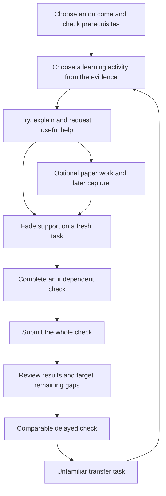

# Unified learning upgrade implementation plan

**Decision:** Finish and install this unified plan first. Further application implementation, hardware work and release are later execution stages.

**Outcome:** A child can understand the task, make a worthwhile attempt, get useful help in learning mode, and later demonstrate independent reasoning, retention and transfer. Family use comes first; the same software must remain independently usable by other families and open-source contributors.

**Executor:** The interactive coordinator executes the stages below. This plan creates no background worker or recurring lane. Existing authorized review sessions supply findings; they do not create a second implementation.

**Status:** Installed unified plan, reconciling the reviewed learning-upgrade plan with the local assessment/interaction foundation and family/hybrid requirements. The assessment and response-control foundation has already been implemented and verified locally; the remaining learning upgrades are planned. No release or learning improvement is established by this document.

## 1. One learning cycle

The unit of design is a complete learning cycle, not a collection of features. The tutor selects an outcome and prerequisites, finds the learner's current gap, chooses an appropriate learning activity, reduces support, and checks what the child can do independently. Delayed checks and unfamiliar applications feed the next learning decision.



The diagram describes learning decisions, not a compulsory screen sequence. Established independent evidence can skip unnecessary worked examples; a missing prerequisite can require teaching before another test. Neither repeated guessing nor waiting for a timer is a prerequisite for requesting help.

Four dimensions stay separate throughout the cycle:

| Dimension | What it describes | What it must not imply |
|---|---|---|
| Knowledge | Factual, conceptual, procedural or metacognitive demands of this task; more than one can apply | A permanent learner type or a route inferred from age/keywords |
| Cognitive demand | The reasoning actually required by the question and rubric, including analysis, evaluation and creation | Difficulty, quality or mastery merely because a task carries a Bloom label |
| Support | Help actually exposed, including access support interpreted against the measured skill | Independent success after teaching has supplied the reasoning |
| Evidence purpose | Supported learning, immediate independent performance, delayed retention, or transfer | Treating these as interchangeable scores |

Higher-order thinking remains an outcome. A learner might compare two explanations, justify a method, diagnose an error, or create examples under constraints. Help should remove a specific obstacle while leaving a meaningful decision to the child. Following a model's worked answer is supported performance even when the prompt says “Create.” A later fresh, unassisted task establishes independent evidence.

## 2. Product and assessment contract

| Surface | Learning mode | Independent assessment |
|---|---|---|
| Instructions and response | Plain wording; number/fraction, choices, steps or explanation controls match the actual task and rubric | Same clarity without supplying the strategy or changing a construction task into recognition |
| Help | Clarify wording, give a clue, compare examples, or work a different example; record the help actually shown and fade it | No content hints, worked steps, coaching or answer keys anywhere in the learner interface |
| Save and waiting | Prompt saved acknowledgment; distinguish checking, retry, missing connection and parent review | Neutral saved/progress acknowledgment; continue without waiting for a verdict that cannot yet be shown |
| Feedback | Useful, accurate feedback at the appropriate learning point; unresolved grades remain pending | No correctness, explanations, adaptive difficulty signals, corrective retries or correctness-dependent rewards until whole-check submission |
| Pause and interruption | Keep the task, draft and save state | Keep the same assessment and its fixed remaining questions; pause, reload or timeout never releases feedback |
| Finish | Learning may continue on a fresh task | Deliberate final/early submission closes the check; unanswered items remain unanswered; review opens and unresolved grades stay pending |
| Later work | A fresh learning or independent attempt has its own identity | A check cannot resume after feedback has been revealed; retries must not duplicate attempts or grading jobs |

Access support follows the existing measured-skill policy. Reading a math instruction aloud differs from reading a decoding item aloud; spoken spelling differs from speaking a math explanation. Freeze permissible accommodations when the check begins, record their use, and apply the same boundary to voice, camera, other tabs/routes and paper review. Parent administration remains available; the learner cannot obtain teaching through an alternate in-app route during an open assessment.

Declare the mode before work begins. The existing `mode='assessment'` is sealed. P5's diagnostic prerequisite, delayed-retention and transfer measurement checks use that sealed lifecycle when presented as a complete assessment. Ordinary `probe`/`harder_probe`, retrieval practice and coaching in learning mode remain unsealed learning activities and must be labeled accordingly; their item-level evidence cannot be described as completion of a sealed assessment. Parameterize the seal tests over every entry point that promises an assessment, including later paper checks.

Clear wording must preserve the target. “Tell me the steps you would use; you do not need to calculate the total” requests a strategy, so the response field and rubric must both ask for steps. Changing that to “What is the first step?” changes the task and requires a corresponding rubric. Technical implementation details stay out of the child's flow.

## 3. Starting state and acceptance boundaries

In the original implementation workspace, the local assessment foundation is described in `docs/release/LEARNING-ASSESSMENT.md`, with source and test hashes in `evidence/assessment-learning-receipt.json`. Those files/source changes remain a P0 integration dependency in the separate review worktree. At this plan's preparation, all 38 recorded source/test/instruction hashes matched. The receipt covers 382 passing default tests, two opt-in skips and 162 unique browser scenarios across the configured desktop/mobile/tablet projects. It records separate reruns after obsolete assessment expectations were corrected; it is not a claim that the first broad browser run had no failures.

This foundation includes server-enforced assessment sealing, same-check pause/resume, explicit final/early submission, neutral answer-save progression, pending results, duplicate handling, access controls and clearer response controls. It updates coaching instructions while reusing the existing help machinery. **It does not yet supply all the substantive worked/completion examples, evidence repairs, latency measurements or family observations planned below.**

The changes are still a local verified snapshot based on `3fb498c`, not an accepted integration commit or a deployment. Preserve them and the user-owned blueprint. Before implementation starts, integrate only the identified reviewed patch into an isolated branch at the accepted upstream baseline; do not copy the entire working tree. Run the sealing tests again after integration and after every subsequent change to question selection, rewriting, rendering or grading.

The separate learning review identified three reproducible synthetic defects: a short default mission can omit an eligible mixed independent slot; a harder later task can be reported as lost retention; and supported correct/confident answers can be counted as independent confidence. It also traced replacement/context gaps in source. Headless review findings must be checked against the accepted baseline: a reviewer given the older source cannot establish a new defect in the locally verified assessment implementation.

Software correctness, usability, real-model quality, device behavior, hosted operation and family learning are separate acceptance claims. No synthetic test count establishes a learning gain.

## 4. Shared evidence and state design

Keep the present TypeScript/Node application, server-rendered interface, SQLite local storage, PostgreSQL hosted storage, job model and versioned runbooks. Use the current Node version and commands in `package.json`. This plan does not replace the deployment architecture in `docs/release/DEPLOYMENT.md` or activate a new model/provider.

Define one evidence contract used by selection, mastery, progress, retention and experiments before expanding teaching routes:

| Evidence element | Required behavior |
|---|---|
| Attempt identity | Stable learner-owned attempt and delivered-question version; a retry of that attempt is idempotent, while genuine later work is distinct |
| Delivered task | Concept/outcome, actual demand, response form, task role, prompt identity, rubric/version and generation provenance belong to the final question delivered |
| Mixed context | Distinguish interleaved sequence context from an explicit discrimination task. Qualifying context must be validated from delivered work, not inherited from a discarded slot or accepted from a model's boolean. The existing mastery gate accepts genuine interleaving; it does not acquire a new requirement for explicit method discrimination |
| Help | Preserve content help, access support, guided/faded exposure and known external help. A rewrite cannot erase earlier exposure and manufacture independence |
| Exposure | Record when relevant in-app teaching, examples and attempts were displayed or made; distinguish confirmed display from unknown delivery so recent practice cannot masquerade as an unrefreshed delay |
| Grade | Confirmed, pending, disputed or invalid item state; keep the rubric/prompt version used. Pending written work remains in the existing session/job boundary until a confirmed grade creates a scored attempt; do not invent nullable correctness in scored attempts. A replacement task cannot retain the discarded task's rubric or transfer designation |
| Comparison | Outcome/parallel-form identity when validated, actual demand, response form, support, freshness and timing. Unknown metadata stays unknown |
| Confidence | The response actually captured, when it was captured and under what help conditions; post-help confidence cannot be relabeled an unaided prediction |
| Timing | Distinguish request/save/queue/model/visible-feedback times and active work/paused time; do not log answers or raw audio to measure latency |

Use additive schema changes only where existing fields cannot represent the contract. Choose validated, bounded enums and conservative defaults, normalize SQLite/PostgreSQL representations, and update mappings, backup/export/deletion and migration checks together. Model output may propose metadata; application validation establishes which claims are usable.

### Historical progress and mixed practice

Do not silently rewrite historical attempts, promote unknown old context to verified evidence, or demote earned progress through an incidental schema upgrade. At an authorized cutover, snapshot pre-change attempt IDs and **already-earned concept/level mastery, due dates and milestone receipts**. The current milestones are derived from attempts, so preserving them requires an explicit durable cutover record, not an assumption that receipts already exist. Preserve these v0 earned claims as historical. For a promotion first earned afterward, old fresh confirmed independent successes can contribute counts, sessions and days, but at least one v1-validated mixed win at that target level is required; a suspect old mixed flag cannot complete a new promotion.

Already excluded `evidenceCertainty=legacy` or unresolved records remain excluded. At cutover, transactionally stamp existing attempts and existing session/item revisions as v0; later submission/grading inherits that item's policy. New writers stamp each new revision and attempt as v1. Post-cutover old-writer rows form an explicit unversioned class: retain valid independent count/session/day contributions, never infer validated mixed context, and do not mint new promotions from their boolean. Do not grandfather all null metadata. Preserve open-item policy/revision identity, pending work and valid raw responses; late grading must not invent v1 provenance. Rollback is read-compatible; pause incompatible old evidence writers while preserving drafts, then preserve recorded receipts on roll-forward. An additive metadata migration cannot silently reset or advance a learner.

A mixed win must belong to the target concept at the same working Bloom as the other qualifying wins, with no disqualifying support. A different-concept warmup, unseen scheduled question, unrelated neighboring subject or higher-Bloom stretch cannot satisfy that target's gate. Actual sequence interleaving and explicit discrimination remain distinct evidence.

Repair mixed provenance, supply reachable qualifying mixed work, and deliver comparable due checks in **one releasable evidence slice (P2–P3)**. Development commits may be separate, but stricter writers/reports cannot ship ahead of reachable work. A learner must not be stranded between stricter eligibility and the arrival of qualifying tasks.

Component readiness for mixed practice must not require the very mixed mastery credit the learner is trying to earn. Use demonstrated independent component performance and approved prerequisites. Exercise the state with enough independent wins across days/sessions but no mixed win: ordinary practice must provide a valid route forward. With no suitable partner or too little time, state that the evidence is unavailable; never manufacture a mixed flag or weaken mastery.

Freeze a positive `mixed-context-v1` rule before changing writers. These are versioned engineering defaults to verify, not claims of optimal pedagogy:

- The partner is a different concept in the same subject, connected by an approved prerequisite, shared prerequisite parent, approved cross-link or authored comparison pair. Persist the relation identifier and map version; subject/word overlap alone does not qualify.
- Both components have at least two fresh confirmed unaided successes on different prompts at their declared component demand before scheduling the pair. This provisional readiness does not require a mixed badge; revalidate at answer time.
- The partner was actually displayed and answered with a fresh confirmed unaided response, not skipped/retired, before the target in the same session and within the previous three delivered positions. Persist partner item/revision, order, timestamps and policy. Planned, later-only, rewritten-away or repeated/skipped partner rows cannot qualify. The target must match its mastery demand; approved component relations may span different component demands.
- The target is displayed on the same recorded learning day and within 30 minutes of the partner answer. A same-day short pause can preserve that context; a longer/next-day resume must obtain a fresh partner first. Never carry context merely because the session ID survived.
- Budget the real partner and target within the mission. Five-/ten-minute evidence-ready routes make room while preserving due review. In every three-minute arc, due review and the declared independent-work/total-work budgets take priority. Skip guided/faded beats only for an evidence-ready learner whose support is redundant, without adding work or dropping required due review. A qualifying already-delivered unaided opening can supply the partner; if a real pair cannot fit the remaining allowance, provide an explicit bounded follow-up and pending state.
- From zero history, rotate from a provisionally demonstrated component to another approved prerequisite-ready component rather than repeatedly choosing `openCourse[0]`. In a two-root always-correct simulation, both reach the assessed Bloom-2 outcome with valid mixed wins within 12 bounded sessions over at least five learning days. Selection must actually change roots without seeded history.
- Where the approved scope structurally has no valid partner, report “independent outcome demonstrated; mixed check not available in this scope.” Finish the bounded block, preserve due review and allow other approved ready work, without inventing a concept, changing parent scope or awarding a mixed-mastery badge. Test a single-concept cold start explicitly.

### Comparable retention and confidence

Prefer authored and validated outcome/parallel-form matches. At minimum, a historical proxy must match concept, actual cognitive demand, task role and fresh confirmed independent conditions, with no known response-form conflict. Missing historical form/outcome metadata may support that explicitly labeled proxy, never a validated match. A known mismatch is ineligible. Equal Bloom labels alone do not establish comparable difficulty.

A switch from understanding tasks to creation tasks yields insufficient comparable retention evidence, not “0% remembered.” Transfer remains a separate result. Apply one comparison policy across parent summaries, adventure/gain reports and experiments, including denominators and uncertainty. An uncontrolled change in task mix cannot establish causal improvement or a standardized effect size.

Each report retains its own time window: a retention delay must not filter out immediate confidence or gain observations. Match a delayed check to a suitable recent prior success at its measured outcome/demand, rather than anchoring all future checks to the concept's first low-level win. Version measurement and experiment rules before examining outcomes. Freeze an active experiment's definition or withhold/restart its verdict at a version change; do not pool versions. Preserve existing milestone receipts and avoid duplicate rewards during replay.

For prospective claims about a week without refresher practice, also measure from the last **recorded in-app exposure** relevant to the concept/outcome/demand. Persist displayed lessons, worked/completion support, failed/assisted/unscored attempts and fresh checks. A day-11 exposure followed by a day-12 success is later review with intervening practice, not seven days of unrefreshed retention from day 4. Historical or unacknowledged display gaps mean “later unaided check; exposure history incomplete,” not invented exposure-free time. This cannot certify absence of school/offline practice. Apply stricter milestone rules prospectively and preserve cutover receipts.

For a strict target delay claim, a displayed prerequisite/comparison partner counts as target exposure when it supplies target-relevant method or answer-equivalent support. Approved outcome mapping may establish that independent retrieval of another component does not refresh the target; unknown overlap cannot establish an exposure-free gap and must remain a proxy. Serve a strict delayed check before a relevant refresher, or label the later target as review after practice. Compute the gap before the current item/check begins; a sealed check is one measurement episode, not multiple independent week-long samples. A delayed item offered in an ordinary learning mission remains item-level evidence, not completion of a sealed delayed assessment; only the declared assessment lifecycle makes that whole-check claim.

Independent confidence uses the declared fresh, confirmed, independent sample and minimum sample threshold. Supported confidence, if useful, has its own label. Neither confidence nor help count is mastery. Missing, small, disputed and mixed-condition samples must remain visible.

## 5. Teaching and interaction design

Approved knowledge dimensions, contrasts, nonexamples and misconception corrections must survive from the subject map through runtime/pack context. Carry stable map/concept keys. A generic “fractions” request must not select the first concept in a lexical tie between magnitude and addition; unknown or ambiguous selection keeps metadata unknown and scope intact. Preserve unknowns for older or built-in concepts. Select the activity for this task and the learner's demonstrated gap, while keeping scope and prerequisites under the existing parent-approved plan.

Keep internal authoring/grading context, teaching context and learner assessment views separate. Authoring may need checked subject matter, misconception fixes and rubric keys. Build allowlisted learner views and check both fields and the meaning of the authored prompt so those keys/fixes do not become hints in the assessment DOM, API, events or processing screens.

| Need | Learning activity | Fade and verify |
|---|---|---|
| Remember a fact | Retrieval with a clear correction when needed | Fresh independent recall, then delayed recall |
| Understand a concept | Compare examples/nonexamples, explain a boundary, diagnose a misconception | A fresh explanation or discrimination without the contrast being supplied |
| Learn a procedure | A separate worked example with the reason for each important decision, then a genuine completion problem | Remove meaningful steps progressively, then a fresh independent problem |
| Choose or justify a method | Compare approaches, explain applicability, judge an error or constraint | Independent choice and justification in an unfamiliar case |
| Create and evaluate | Construct an example under constraints, test it and defend it | A fresh constrained task scored against an explicit rubric |

These are starting routes, not a rigid matrix or fixed learning styles. Existing evidence can skip redundant instruction, and one task can combine several dimensions. A generic sentence such as “Think about the steps” is not a worked example. A faded problem must leave an actual cognitive step to complete. Do not use a future independent question as the teaching example or expose its answer key.

A help request should make the child's next action clearer without shame or a score penalty for help seeking. After supported success, offer a fresh independent task. Generation failure retains saved work and provides a truthful retry/fallback; unavailable validated content cannot become fabricated mastery evidence.

For waiting, measure the separate parts of the turn before choosing a performance fix. A slow grading job does not automatically mean a parent must grade. Show “Saved,” actual checking progress, connection recovery or parent review according to the real job state. The assessment foundation removes an inter-question processing screen; real-model latency still needs measurement. Improve parent setup/summaries only after the child's core turn is understandable, and show evidence conditions rather than a reassuring but unsupported score.

## 6. Execution stages and gates

The stages implement the single cycle above. Each stage produces a bounded verified change with exact source/evidence pointers. Tests should exercise meaningful failures and boundaries; do not add tests that only mirror implementation. A local commit does not authorize merge, publication or production deployment.

| Stage | Integrated output | Dependencies and release gate |
|---|---|---|
| P0 | Accepted foundation and an explicit evidence/migration contract | Identified assessment snapshot integrated and sealing suite green |
| P1 | Content/publication boundaries | Must pass before any shared export; runs throughout later stages |
| P2 | Trustworthy mixed evidence and a reachable path to earn it | P0; historical and two-database checks pass; release together with P3 |
| P3 | Honest retention/confidence reporting and reachable comparable due checks | P0/P2 evidence contract; all affected writers/reports agree; completes the atomic P2–P3 evidence release |
| P4 | Knowledge-specific teaching and clearer help/waiting | P0–P3; actual support and response/rubric alignment remain truthful |
| P5 | One complete fractions learning cycle | P2–P4 plus assessment sealing, failures/recovery and delayed/transfer checks |
| P6 | Family usability and learning evaluation | Protocol prepared early; conclusions require the tested P5 build and actual observations |
| P7 | Optional paper/Jetson interface to the same cycle | P5 evidence/state contract; physical-device proof separate from browser simulations |
| P8 | Equivalent shared distribution and any authorized rollout | P1 plus accepted relevant stages; release checks and actual action-specific authorization |

P7 is optional and cannot block the core software learning cycle or become an excuse to redesign storage. P6 begins with defining outcomes and observing current friction; a complete long-term study is not required to correct a reproduced software defect. Widening teaching claims requires its outcome evidence.

### P0 — Establish a reproducible foundation

**Inspect:** `package.json`, `src/assessment.ts`, `src/services.ts`, `src/session-feedback.ts`, `skills/assess-learning/SKILL.md`, `src/runbook/versions.json`, `test/assessment-flow.test.ts`, `test/browser/assessment.spec.ts`, and current release evidence.

1. Record exact private/public branch tips and shared-file differences. Preserve the original dirty workspace, user files and learner stores.
2. Create an isolated implementation branch from the accepted upstream baseline. Identify and integrate the verified assessment patch by a reproducible reviewed commit, with its source manifest and test receipt. A merely noted assessment dependency does not unlock changes to shared services.
3. Specify mixed-context semantics, historical replay policy, readiness without circular mastery, comparison/confidence rules and additive data fields. Record unresolved evidence as unknown rather than inventing backfills.
   Before any branch push containing migration/writer changes, prove preview database/schema/storage isolation with non-secret identity fingerprints. A feature push may create a hosted preview; if isolation is unknown, keep work local or use a separately authorized non-hosting path. Evidence cutover/snapshot is an explicit authorized release step; a production-identified or unknown resource must not receive it implicitly at preview boot. This pre-push gate applies throughout implementation, not just at P8.
4. Run `npm run typecheck`, `npm test`, and the assessment browser specs on the integrated baseline. Attribute any failures to the actual tested revision.

**Acceptance:** Exact integration commit, baseline verdict, retained original snapshot, explicit policy and passing assessment seal. No later behavior stage starts against an unresolved assessment merge.

### P1 — Keep private sources and runtime records outside shared delivery

**Inspect/modify as needed:** `scripts/export-public.sh`, `.vercelignore`, export tests and CI. **Expected new artifacts:** `scripts/check-public-content.mjs` and synthetic checker fixtures; these are not produced by planning.

1. Verify tracked private folders and stale private files in an old export target are excluded/removed, while shared application files remain. Verify deployment-package exclusions independently.
2. Add a generic public-tree checker with safe synthetic fixtures, runnable without private source material. Reject private/runtime directories and disallowed sensitive artifacts; explicitly allow documented environment examples.
3. Add an upstream-only normalized text-overlap candidate check and execute an origin/diff audit of changed shared runbooks, source, examples and fixtures. A synthetic private sentence copied into an otherwise allowed shared file must fail the private check even under case/whitespace changes, while the public path checker can pass. Put the private detector, planted fixtures, fingerprints and matched excerpts under an excluded private path and assert their absence from export; the generic public checker must not embed private identifier lists. Publish only opaque findings/paths. Resolve common-phrase candidates locally; no blanket waiver or owner review handoff. Neither a path-only filter nor a clean overlap scan certifies all paraphrase or rights.
4. Verify the public tree builds and runs without private membership content. Keep source-linked research, reviewer packets and family records private.

**Acceptance:** Independent public build, clean synthetic export regression, checked shared diff and deployment artifact, and no corpus/runtime dependency. Preserve existing filters; do not replace them with a raw mirror.

### P2 — Repair mixed evidence and progression together

**Modify:** `src/engine/types.ts`, `src/engine/select.ts`, `src/engine/arc.ts`, `src/engine/mastery.ts` and `src/services.ts` (`startTutorSession`, `claimPractice`, `rewriteItem`, `loadAttempts`); versioned additive provenance in `src/db.ts`, `src/migrations.ts` and the next available migration. Allocate its number during implementation, not from a stale plan.

**Tests:** `test/mission-arc.test.ts`, `test/engine.test.ts`; expected new focused `test/practice-provenance.test.ts` and a disposable parity harness at `test/parity/postgres-provenance.ts`. Give parity an explicit isolated command outside the default `test/*.test.ts` glob: ordinary unit/public CI must work without PostgreSQL or a production DSN. Record the exact command before completing this stage; private release must execute it separately.

1. Reproduce the short-mission omission and standalone-pack replacement. Write failing cases for replacement, fallback, rewrite and resume. Audit every mixed writer, including arcs, ordinary sessions, `probe`/`harder_probe`, diagnostic queue slots, due review and practice substitution. A probe tail with only an undelivered prerequisite pointer cannot qualify. Verify failures are the intended evidence defect.
2. Derive all prompt-owned fields from the final delivered version: mixed context, partner/contrast, demand, response/rubric, freshness and transfer role. Regenerate or clear incompatible fields atomically. Never retain the old rubric or transfer flag on an unrelated replacement, and never reset exposed guided/faded help into independence. Do not rewrite an already shown independent item or any open-assessment item in place; permitted replacements get a separate identity. Fence late grades and confidence writes to the submitted/current item and rubric revision. Test persisted rows through submission, grading, `loadAttempts`, `independent()` and `masteryMet()`, including retries.
3. Implement the positive mixed-context policy, including three-/five-/ten-minute budgets, invalid relations, skipped/repeated/unshown/later-only partners and short/next-day pauses. Assert persisted partner identity/order/revision through submission. Run both the no-history two-root progression and structurally single-concept bounded-finish simulations; preseeded-ready fixtures alone are insufficient.
4. Exercise three fresh qualifying wins across at least two sessions and two days at the same target concept/Bloom. Negative cases with only a different-concept warmup or higher-level stretch cannot qualify. Verify save/reload and full replay against cutover controls: already-earned v0 mastery stays; two v0 wins including a suspect mixed flag plus a v1 non-mixed win cannot newly promote; adding a validated v1 mixed win can. Cover unversioned old-writer rows, open paused items, pending grades and duplicate late callbacks. Preserve earned due dates/milestone IDs and valid non-mixed contributions; null provenance never creates new mixed credit.
5. Run identical fixtures on SQLite and disposable nonproduction PostgreSQL, covering fresh install, populated historical upgrade, repeat migration and old-reader/new-writer compatibility. Preserve existing integer 0/1 flags and explicitly normalize new version/JSON fields. Deep-compare projected attempts, eligibility, mastery and retention; document rollback limitations. Never run the new harness using production environment files or learner records.

**Acceptance:** No false mixed/transfer/independent claim from replacement; eligible learners can earn the required evidence; no circular readiness dependency; legacy history and state agree; both database paths and assessment sealing pass. Release requires P3's reporting and comparable-due-work gate as well as this stage's provenance/reachability.

### P3 — Make every evidence summary tell the same truth

**Modify:** `src/learning-metrics.ts`, `src/engine/types.ts`, `src/services.ts` attempt projection/selection, `src/engine/arc.ts`, `src/engine/adventure.ts`, `src/engine/gain.ts`, `src/experiments.ts`, exposure persistence and parent labels in `src/view.ts` where needed.

**Tests:** `test/learning-metrics.test.ts`, `test/engine.test.ts`, focused experiment/gain cases and the affected parent browser spec.

1. Reproduce earlier understanding wins followed by later creation misses; require insufficient comparable retention evidence instead of zero retention. Implement one versioned eligibility/comparison policy across consumers with report-specific windows. Find the most recent eligible prior matching success at least seven days earlier for the existing retention report; do not change that constant into a universal or scientifically optimal interval.
2. Prefer validated outcome/parallel-form identity. Label coarse comparisons as proxies only when their stated matching conditions hold; incompatible/unknown evidence cannot silently enter a denominator. Keep transfer separate.
3. Freeze time and cover matching successes/misses, changed demand/format/role, missing metadata, hints/access support, repeated prompts, pending/disputed grades, insufficient intervals and sample sizes. Preserve the existing same-demand 80% retention case as labeled historical proxy evidence. A Bloom-1 win on day 0, Bloom-2 wins on days 2–4 and fresh Bloom-2 review on day 12 must pair with day 4. Pending written session items create no scored attempt before confirmation.
4. Reproduce five supported sure/correct responses without independent examples. Independent confidence must remain unavailable. Persist capture order/time, item revision and support at capture and answer. Cover confidence→hint→answer, hint→confidence→answer, retries/stale-item writes and unknown historical order. Help before the answer makes the response supported even if confidence came first. Preserve the expressed value and label any supported measure separately.
5. Match/stratify both before/after windows and experiment arms; keep missingness and sample counts visible. With unmatched demand/role mix, withhold `enough`, effect-size labels and feature verdicts, rather than displaying a numeric effect with a footnote. Test six low-demand wins followed by six higher-demand misses and policy-version changes in enrolled experiments. Preserve historical milestone IDs/dates without duplicate rewards and ensure current-level comparable delayed opportunities remain reachable.
6. Add displayed-exposure recording before prospective retention claims. Day-4 success → day-11 hinted/guided/failed/shown-worked exposure → day-12 independent success produces no new seven-day unrefreshed pair or milestone. The control without intervening exposure counts. Preserve historical incomplete-exposure results only as labeled proxies.
7. Add a scheduler/service gate in this evidence slice: a due concept with prior eligible Bloom-2 practice success must receive a fresh independent same-concept/Bloom/role check without requiring parent focus. Retain validated outcome/form identity or declare a proxy. Test the scheduled item after `claimPractice` replacement; a Bloom-6 task, transfer substitute, hinted task or other-concept warmup alone fails the writer gate. Honest empty reports are insufficient when the app cannot offer comparable work.

**Acceptance:** Consistent eligibility and denominators across all affected reports; honest uncertainty; unchanged original responses; evidence quality is separate from confidence and performance.

### P4 — Deliver appropriate teaching through a clear turn

**Modify:** `src/subject-map.ts` (`mapBrief`), `src/pack.ts` (`mapContext`), `src/pack-runbooks.ts`, concept projection/types, `src/engine/items.ts`, relevant teaching/rendering in `src/services.ts` and `src/view.ts`, `public/session.js`, `skills/coach-through-question/SKILL.md`, `skills/design-questions/SKILL.md`, affected `skills/pack-*` runbooks and `src/runbook/versions.json`.

**Tests:** `test/subject-map.test.ts`, `test/pack.test.ts`, `test/mission-arc.test.ts`, `test/coaching.test.ts`, `test/runbook.test.ts` and focused learning/feedback browser specs.

1. Carry approved dimensions, contrasts/nonexamples and misconception fixes into runtime using stable map/concept keys. Test confusable fraction magnitude/addition names, correct explicit keys, ties, unknown and built-in concepts. Verify distinct rendered teaching routes, not just metadata presence. Keep schemas validated, context bounded, and runbook versions/fingerprints synchronized with consuming code. Run assessment sealing immediately after context changes, including semantic answer leaks in prompts and allowlisted learner payloads.
2. Produce a separate checked worked example with reasons, a real completion problem and a fresh independent task. Reject generic directions masquerading as worked steps and teaching examples that disclose a later assessed item or answer-equivalent copy. Ordinary prior instruction does not mark every later fresh unaided parallel task as assisted; current-task/answer-equivalent exposure does.
3. Select the route by the demonstrated gap and task. Let prior independent evidence skip needless scaffolds. Preserve analysis/evaluation/creation tasks and explicit rubrics; help must not silently reduce the measured outcome.
4. Verify controls, task wording and rubrics agree for numeric, choice, steps and extended reasoning. Record format/navigation assistance separately from content help. Test keyboard, voice where appropriate, autosave and small-screen recovery.
5. Instrument real state transitions without answer content. Test successful, slow, interrupted, failed and unavailable-AI turns, separating saved work from queued grading and actual parent-review requirements. Measure a real-model turn only under existing provider/privacy authorization.
6. After the core turn passes, keep the next mission and a short capability notice within the initial phone/tablet view while preserving themes, homework and exploration. Verify age presentations rather than generalizing from one fixture. Improve the existing parent next-action summary and supported-connection path only where observed friction warrants it; preserve advanced provider choice, honest capability/billing information and grade disputes. Connection setup does not bypass provider-access gates. Proposed setup-time targets are observations to define, not accepted performance benchmarks.

**Acceptance:** Concrete useful help, honest support records, fresh independent follow-up, task/control/rubric agreement and truthful waiting. Every affected assessment sealing test still passes; failed generation preserves work.

### P5 — Prove one complete fractions route

**Expected new artifacts:** `test/fixtures/learning-routes.ts`, `test/browser/learning-routes.spec.ts`, and a route verification receipt. Reuse existing assessment/learning specs; change only the behavior required by the preceding stages.

1. Define distinct outcomes for magnitude/equivalence, adding unlike fractions and choosing an operation, with approved prerequisites and validated comparable forms. Include analysis, evaluation and creation where the task actually requires them.
2. Exercise prerequisite evidence → targeted teaching → faded support → fresh independent whole check → submitted review → comparable delayed check → unfamiliar transfer. Advance a frozen clock and assert at least one genuinely comparable retained pair, not merely a delayed-check page or empty report. An error or missing prerequisite must lead to an appropriate next learning decision.
3. Verify the full evidence chain: delivered versions, support exposure, rubric, save/resume, duplicate retries, pending grades, skips/early finish, neutral assessment progression and review after final submission. Test a failed generation/checker and a direct alternate-help request.
4. Run the new route across all configured browser projects with isolated synthetic families and an injectable server clock used by selection, retention, source windows, exposure records and session timing. Advance that clock through the live scheduling path and assert the server-reported day changes; changing only browser time or inserting backdated rows after the route starts is insufficient. Test-clock controls must not exist in production. Run required unit/type/build checks on the exact integration commit. Model-written content and physical-device behavior receive separate evidence.

**Acceptance:** The learner can complete the cycle without false mastery or stranded progress. A synthetic script demonstrates software behavior; it does not establish comprehension or transfer by actual children.

### P6 — Observe family use and measure learning honestly

**Artifacts:** A private protocol/results record; an original public aggregate methodology only under its applicable publication authorization. Use `docs/ux/FAMILY-SESSION-KIT.md`, `docs/EVALUATION-PLAN.md` and `docs/release/CHILD-TESTING.md` as existing inputs.

1. Before outcomes, specify the route/build, comparable forms, learning time, support rules, delay window and decision rule. Constants in code are not evidence of an optimal schedule or universal success target.
2. Observe whether children understand what to submit, find useful help, know their work is saved and resume without a parent explaining the interface. Record parent effort and willingness to return as distinct outcomes.
3. Measure independent immediate, comparable delayed and unfamiliar transfer performance, with actual support, time, sample size and missingness. Report submit-to-save and feedback waiting separately from active thinking time.
4. Keep any week-on/off comparison exploratory; order, topic and school exposure may confound it. Adjust reproduced friction promptly, then evaluate the affected build before widening claims or rollout.

**Acceptance:** Usability observations and learning evidence support only their stated conclusions. No “more help,” “less help,” faster completion or passing test suite by itself establishes better learning. Preserve family responses/images privately.

### P7 — Add the optional paper and Jetson route

The owner already has a Jetson Orin board and plans a camera, microphone and screen. Verify variant, memory, peripherals and installed software when executing the prototype. Hybrid cloud assistance is acceptable; fully offline AI is not a starting requirement.

**Inspect first:** `src/engine/sheets.ts`, worksheet/QR generation and question mapping, `src/schoolwork.ts`, `src/direct-uploads.ts`, `src/upload-reservations.ts`, existing device/recovery/browser specs and `docs/release/DEPLOYMENT.md`. Add only the missing lifecycle behavior proved by the walkthrough.

1. Choose/print work → complete offline → photograph now or later → upload when connected → confirm captured question/answer → grade/review → fresh independent follow-up. Reuse worksheet and attempt identity; a repeated upload is not a new success, while genuinely later work is a distinct attempt.
2. Distinguish paper completed, photo retained on the device, uploading, unreadable, awaiting checker and checked. Do not promise a local/offline photo save before storage/permission/recovery has actually succeeded. Verify retention, clearing on shared-device sign-out and appropriate family ownership.
3. Keep paper assessment answer keys and teaching hidden until declared submission. Record the conditions and known outside help; unsupervised paper work is self-reported independence, not certified observation. Resolve unreadable capture before scoring.
4. On the physical board, test camera framing, understandable spoken prompts, visible microphone state and stop control, touch targets, save/resume and interruption recovery. Compare spoken and typed turns without claiming fixture timing as device performance.

**Acceptance:** One complete physical-device paper/capture/feedback cycle with explicit evidence conditions and no duplicate learning credit. No new always-on capture, manufacturing scope, local-model promise or provider activation is implied. Core software stages remain useful without this optional prototype.

### P8 — Distribute one shared implementation and release only the verified scope

**Verify:** `npm run typecheck`, `npm test`, affected browser projects, `npm run build:assets`, `npm run check:function-build`, public export/content checks and exact-export CI. Re-read current `docs/release/STATUS.md` and deployment instructions before a release claim or action.

1. Accept the coherent implementation slice at an exact upstream commit, including evidence, migration parity/rollback limits and known exclusions. P2–P3's provenance, mixed reachability, comparable due work and reporting must remain together. Execute the pre-push preview-isolation/production-cutover guard from P0 before migration/writer branches can trigger hosting.
2. First compare public main with the last accepted export manifest. Reconcile/back-port public-only contributions and CI fixes into the upstream, or stop export; listing differences alone does not clear this gate. Export from an isolated checkout of the accepted commit into a separate public feature branch; never export the active dirty workspace or raw private history. Require a slice-scoped diff: unexpected modifications/deletions outside the accepted slice/reconciliation fail the gate. Run P1 checks and compare shared implementation/test hashes against the export manifest.
3. Run required shared checks in the exported tree, without a private corpus. Prepare a bounded public branch/PR and original changelog with software evidence only; record source/export revisions and CI verdicts.
4. Follow actual merge/publish/deploy authorization at the action boundary. Pushing upstream main can build production in the existing deployment setup; planning is not permission to do so. No new credentials, paid inference or live camera/audio service is activated by this plan.
5. After any authorized deployment, verify the actual hosted source/assets, migrations and affected journeys separately. Preserve learner history during rollback and explicitly state when schema/data is only forward compatible.

**Acceptance:** Equivalent independently usable shared software, no private source/learner material in public artifacts, and separate truthful statements about local checks, public CI, hosted behavior, devices and learning outcomes.

## 7. Executable verification contract

These are implementation checks, not claims that planning ran the application suite again. Existing checks run when their dependent code changes; newly named tests/harnesses are expected artifacts until created.

```bash
npm run typecheck
npm test
node --experimental-strip-types --test test/mission-arc.test.ts test/engine.test.ts test/learning-metrics.test.ts
node --experimental-strip-types --test test/assessment-flow.test.ts test/coaching.test.ts test/runbook.test.ts
npx playwright test test/browser/assessment.spec.ts test/browser/feedback.spec.ts test/browser/recovery.spec.ts
# After P5 creates the route spec:
npx playwright test test/browser/learning-routes.spec.ts
npm run build:assets
npm run check:function-build
git diff --check
```

P2 must add and execute an isolated PostgreSQL parity/migration check outside the default unit-test glob rather than sourcing a production environment file. It must reject non-isolated resources and clean only its own fixture resources; public unit CI needs no database service. P1 must add and execute the generic public-content check and keep the existing private export regression. P8 runs exact-export CI and authorized hosted verification. Those commands must be recorded when their harnesses exist; an absent harness is not a passing check.

Every behavioral stage rechecks assessment sealing, including direct endpoints, hints at every rung, adaptive rewrites, cross-session/material routes, pending jobs/events, pause/resume, skipped/unanswered items and feedback after explicit final submission. Preserve successful local coverage rather than deleting failing cases to make a merge pass.

The plan itself is done when its requirement crosswalk is complete, referenced existing paths resolve, expected artifacts are distinguished, the original verified source/user files are unchanged, accepted review findings have dispositions and both sessions hold the same canonical plan. A plan validation receipt records those executed checks and synchronization hashes.

## 8. Requirement crosswalk and completion gate

| Requirement/input | Integrated location | Proof required during execution |
|---|---|---|
| Family first; clearer questions/controls and less confusing waiting | Sections 1–2, P0/P4/P6 | Task/control/rubric tests, actual latency states and family observation |
| Useful help without replacing independent higher-order thinking | Sections 1/5, P3–P6 | Actual help exposure plus fresh independent, delayed and unfamiliar tasks |
| No assessment help or feedback before whole completion | Section 2, P0 and every behavioral stage | Server/route/job/rewrite sealing and explicit-submission regression suite |
| Original baseline/publication tasks 0–1 | P0–P1/P8 | Exact integration, export/deployment exclusions and public build |
| Original mixed provenance/reachability tasks 2–3 | Section 4/P2–P3 | Atomic evidence delivery, genuine context, cold-start progress, comparable due work and legacy/parity proof |
| Original comparable retention/confidence tasks 4–5 | Section 4/P3 | Shared matching rules, conservative unknowns and independent-only calibration |
| Original knowledge context/worked support tasks 6–7 | Section 5/P4 | Approved metadata survives, real worked/completion tasks and fresh follow-up |
| Original complete fractions route task 8 | P5 | Full learning cycle across configured browser projects |
| Original shared distribution/family tasks 9–10 | P6/P8 | Exact shared export, appropriate authorization and separately measured family benefit |
| Open-source software plus optional owned hardware/hybrid paper | P1/P7/P8 | Independent public build and separately verified physical-device lifecycle |
| Cross-session review and complete synthesis | This document and local plan verification receipt | Adjudicated findings, matching canonical copies and acknowledged handoff |

The first implementation unit is P0, followed by the P1 boundary checks and the complete P2/P3 evidence repair. P4/P5 then establish the teaching cycle on a trustworthy foundation. P6 supplies observations and outcome evidence; P7 remains optional, and P8 distributes only the verified authorized scope. No unchecked item becomes complete merely because the plan is installed.
