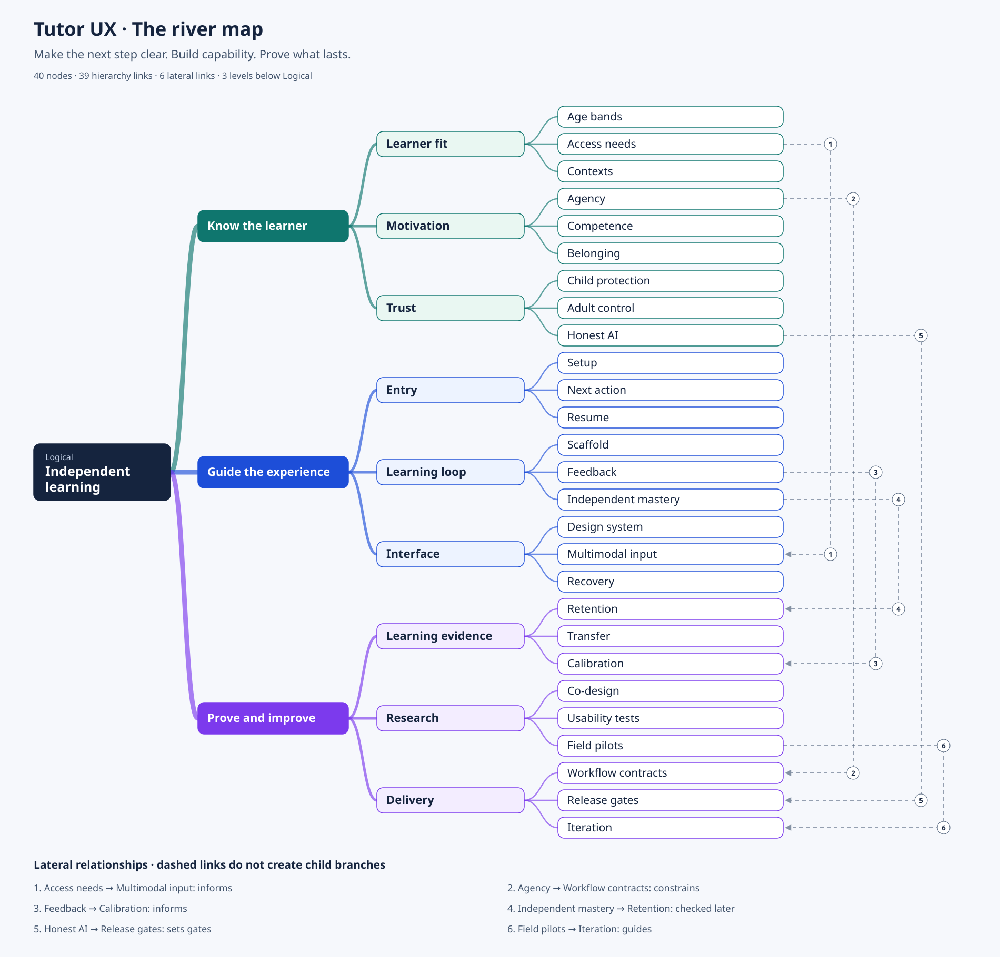

# Tutor UX framework and process series

**Goal:** Children can operate the tutor independently, learn to solve fresh work without solution help, and return willingly after a clear finish. Parents can understand the evidence and take one useful next action.

This package contains a repository-grounded design framework, an exact river mind map, workflow contracts, and a repeatable process for research, design, engineering and release.

**Status:** documentation and proposed acceptance contracts. The source audit inspected commit `97b0295982f0925abce49d54065309ae453a3487`. This package does not implement a UI redesign, change learning rules, run a child study, certify accessibility, or demonstrate learning gains.

## Read and use the package

| Document | Use it for |
|---|---|
| [RIVER-MAP.md](RIVER-MAP.md) | Vocabulary → relationships → chunks → full Mermaid → rendered diagram → seven-column definitions for all 40 nodes. |
| [FRAMEWORK.md](FRAMEWORK.md) | Product principles, age/device fit, child and parent experience, teaching support, engagement, accessibility and evidence. |
| [WORKFLOWS.md](WORKFLOWS.md) | Nine trigger-to-exit contracts, formal states, recovery behavior and evidence effects. |
| [PROCESS-SERIES.md](PROCESS-SERIES.md) | Twelve sequential SOPs with owner roles, inputs, method, outputs, exit gates and handoffs; delivery sequence and SMART card. |
| [QA-SCORECARD.md](QA-SCORECARD.md) | Separate outcome panels, proposed targets, denominators, unknown states, blockers and the release judge. |
| [AGENT-PROMPTS.md](AGENT-PROMPTS.md) | Reusable instructions for the orchestrator, researcher, flow architect, designer, implementer and independent QA reviewer. |
| [REPO-AUDIT.md](REPO-AUDIT.md) | Current code findings, historical-document caveats and prioritized minimal improvements. |
| [RELATIONSHIPS.md](RELATIONSHIPS.md) | Every term explicitly related to all 39 other terms; indirect connections are distinguished from direct dependencies. |
| [VALIDATION.md](VALIDATION.md) | Checks performed on this documentation package and what remains unverified. |



[Scalable SVG](assets/river-map.svg) · [PNG](assets/river-map.png) · [Mermaid source](assets/river-map.mmd) · [Node data](assets/river-map.json) · [All 780 pair relationships](assets/all-relationships.json)

## Recommended first work cards

These are proposed work cards, not assigned or completed work. Set an accountable person and an absolute due date at kickoff. Keep the supplied role when one person holds multiple responsibilities.

| Order | Type / owner role | Concrete result | Acceptance evidence |
|---|---|---|---|
| 1 | Execution / product + learning lead | Correct the parent evidence labels and evaluation-document claims. | No h-to-2σ equivalence; descriptive comparisons labeled honestly; task demand not presented as interval difficulty. |
| 2 | Execution / engineer | Preserve coaching drafts until acknowledgement and isolate them by learner. | Failed send, ambiguous receipt, reload, duplicate retry and sibling-switch cases. |
| 3 | Execution / engineer + accessibility reviewer | Separate reduced motion, reading and shared-device preferences. | All four motion/reading combinations and two learners on one device. |
| 4 | Execution / engineer + designer | Make setup, child home and parent controls share a truthful capability state. | No AI, working AI, revoked access, exhausted usage and unavailable photo model each lead to a usable action. |
| 5 | Exploration / researcher + learning lead | Identify barriers across the full early-reader wrong-answer/help/finish journey. | Observed tasks, counts of navigation help versus teaching help, a non-number task and stated sample limits. |
| 6 | Execution / designer + engineer | Improve one child journey and its parent evidence view using findings. | Relevant WF acceptance IDs, real persistence, recovery, manual access checks and independent review. |
| 7 | Exploration / pilot lead | Learn whether the usable journey supports independent retention and transfer. | Predeclared matched tasks, cohort and follow-up dates; 7/28-day outcomes mature on their actual dates. |

## Start an agent or team session

1. Read the current `PRODUCT.md`, `DESIGN.md`, relevant engine rules and this audit. Recheck the latest code; the audited SHA is a snapshot.
2. Select one card and one outcome. Do not turn a clear improvement into a full theme, architecture or curriculum rewrite.
3. Copy the matching prompt from [AGENT-PROMPTS.md](AGENT-PROMPTS.md). Supply the workflow ID, acceptance conditions, source evidence, owner and due date.
4. Require the exact change and its validation evidence at handoff. Code tests, observed usability and learning results are separate kinds of evidence.
5. Apply the independent judge in the scorecard before expanding exposure.

## Rebuild the map

Edit `assets/river-map.json`, then run:

```bash
python docs/ux/assets/build-river-map.py
```

The standard library builds SVG, Mermaid, the definition document and the complete relationship analysis. Optional PyMuPDF builds the PNG. The script validates a single root, unique nodes, 2–3 children or none, depth, and complete pair coverage. The current map has three children at every nonterminal node and only three levels below Logical.

Keep real children's data outside the repository. All examples in this package are synthetic or generic.
