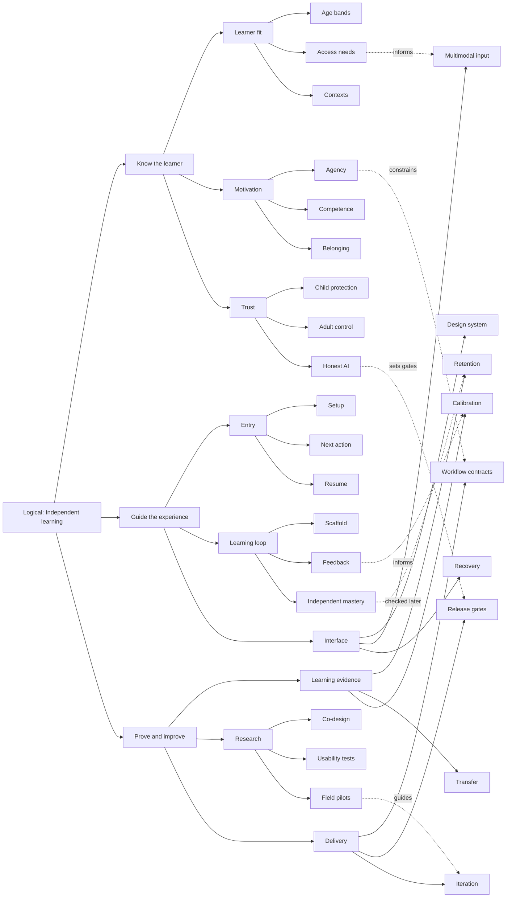

# Tutor UX: river-style mind map

This map is a proposed framework grounded in the repository audit. The Logical trunk has three children. Every other nonterminal node has three children. There are three hierarchy levels below Logical. Dashed lateral links are relationships, not hierarchy branches.

## 1. Vocabulary list

Independent learning; Know the learner; Learner fit; Age bands; Access needs; Contexts; Motivation; Agency; Competence; Belonging; Trust; Child protection; Adult control; Honest AI; Guide the experience; Entry; Setup; Next action; Resume; Learning loop; Scaffold; Feedback; Independent mastery; Interface; Design system; Multimodal input; Recovery; Prove and improve; Learning evidence; Retention; Transfer; Calibration; Research; Co-design; Usability tests; Field pilots; Delivery; Workflow contracts; Release gates; Iteration.

## 2. How it relates analysis

The table names the main relationship for every node. [RELATIONSHIPS.md](RELATIONSHIPS.md) explicitly classifies every term against all other terms; its JSON companion covers all 780 unordered pairs. Unconnected topics share the goal without an invented causal dependency.

| Term | Main relationships |
|---|---|
| Independent learning | Receives the learner, experience and evidence branches. |
| Know the learner | Groups learner fit, motivation and trust. |
| Learner fit | Combines age bands, access needs and contexts. |
| Age bands | Informs learner fit and the shared design system. |
| Access needs | Directly informs multimodal input and usability tests. |
| Contexts | Constrains setup, resume, input and recovery. |
| Motivation | Combines agency, competence and belonging. |
| Agency | Guides workflow contracts and the finish screen. |
| Competence | Connects motivation with feedback and independent mastery. |
| Belonging | Shapes feedback, adult handoff and child protection. |
| Trust | Groups child protection, adult control and honest AI. |
| Child protection | Constrains setup, input, release gates and retention of data. |
| Adult control | Connects setup, parent review, workflow contracts and trust. |
| Honest AI | Sets conditions for release gates and calibrated feedback. |
| Guide the experience | Groups entry, the learning loop and interface behavior. |
| Entry | Combines setup, next action and resume. |
| Setup | Depends on adult control and current capability state. |
| Next action | Uses learner evidence, contexts and workflow contracts. |
| Resume | Connects entry, recovery, saved drafts and retention. |
| Learning loop | Combines scaffold, feedback and independent mastery. |
| Scaffold | Works with feedback and fades before independent evidence. |
| Feedback | Feeds calibration and selects appropriate scaffolding. |
| Independent mastery | Must be checked later through retention and transfer. |
| Interface | Combines design system, multimodal input and recovery. |
| Design system | Expresses age, access, trust and workflow requirements. |
| Multimodal input | Implements access needs and relies on recovery. |
| Recovery | Supports resume, input, feedback and workflow contracts. |
| Prove and improve | Groups learning evidence, research and delivery. |
| Learning evidence | Combines retention, transfer and calibration. |
| Retention | Checks independent mastery and informs future review. |
| Transfer | Extends independent mastery and learning evidence. |
| Calibration | Uses feedback and supports honest reporting. |
| Research | Combines co-design, usability tests and field pilots. |
| Co-design | Informs learner fit, motivation and prototypes. |
| Usability tests | Checks interface independence and informs iteration. |
| Field pilots | Supplies evidence for iteration and controlled release. |
| Delivery | Combines workflow contracts, release gates and iteration. |
| Workflow contracts | Expresses agency and connects design to implementation. |
| Release gates | Enforces honest AI, access, recovery and learning rules. |
| Iteration | Uses field pilots, usability findings and release gates. |

### Lateral links

| From | To | Why |
|---|---|---|
| Access needs | Multimodal input | Access needs determine which input alternatives and accommodations must be usable. |
| Agency | Workflow contracts | Agency requires workflow contracts to preserve choice, help, pause and stopping. |
| Feedback | Calibration | Feedback helps the child judge understanding and exposes uncertain judgments for review. |
| Independent mastery | Retention | Independent mastery claims need later evidence of retention at an appropriate objective and demand. |
| Honest AI | Release gates | Honest AI requires release gates for truthful claims, uncertain judgments and usable challenge paths. |
| Field pilots | Iteration | Field pilots provide repeated-use evidence for decisions to keep, revise or stop a change. |

## 3. Chunk groups

| Parent | Child 1 | Child 2 | Child 3 |
|---|---|---|---|
| Independent learning | Know the learner | Guide the experience | Prove and improve |
| Know the learner | Learner fit | Motivation | Trust |
| Learner fit | Age bands | Access needs | Contexts |
| Motivation | Agency | Competence | Belonging |
| Trust | Child protection | Adult control | Honest AI |
| Guide the experience | Entry | Learning loop | Interface |
| Entry | Setup | Next action | Resume |
| Learning loop | Scaffold | Feedback | Independent mastery |
| Interface | Design system | Multimodal input | Recovery |
| Prove and improve | Learning evidence | Research | Delivery |
| Learning evidence | Retention | Transfer | Calibration |
| Research | Co-design | Usability tests | Field pilots |
| Delivery | Workflow contracts | Release gates | Iteration |

## 4. Mermaid mind-map code

## 5. Rendered diagram

[Open the scalable SVG](assets/river-map.svg) · [PNG preview](assets/river-map.png) · [Mermaid source](assets/river-map.mmd)

## 6. Definitions table

| Word | Quick Definition | Why It’s Important | How It Relates (to help chunking) | Deep Dive | Example | ELI5-Style Explanation |
|---|---|---|---|---|---|---|
| Independent learning | The logical goal: capability the child can use without solution help. | Keeps usability, learning and healthy return aligned. | Receives the learner, experience and evidence branches. | Measure interface independence and learning independence separately; preserve a voluntary stopping point. | Solve a fresh task next week. | You can do it yourself. |
| Know the learner | Understand the people and conditions the tutor must serve. | Prevents a polished experience for the wrong user. | Groups learner fit, motivation and trust. | Use observed needs and explicit preferences; age alone cannot define reading or subject ability. | A strong reader who needs larger controls. | Learn who needs what. |
| Learner fit | Match presentation and tasks to the actual learner. | Reduces avoidable effort before teaching starts. | Combines age bands, access needs and contexts. | Separate interface complexity, reading support and subject readiness. | Advanced math with spoken instructions. | Make the tool fit you. |
| Age bands | Initial presentation defaults for 5–7, 8–10 and 11–14. | A five-year-old and teenager need different presentation. | Informs learner fit and the shared design system. | Use the repo's bands, then permit support overrides without changing mastery rules. | Large tiles and Hear this for 5–7. | Start with a suitable size. |
| Access needs | Supports for seeing, hearing, reading, moving and communicating. | Allows a child to show knowledge through a usable interface. | Directly informs multimodal input and usability tests. | Keep motion, speech and reading support independent; verify the assessed skill survives the accommodation. | Read a math prompt aloud. | Give everyone a usable way. |
| Contexts | The setting, device, connectivity and adult availability. | An interface must work where learning actually occurs. | Constrains setup, resume, input and recovery. | Test phone, tablet, laptop, shared devices and interrupted use separately. | Homework on an iPad at the kitchen table. | Where and how you learn. |
| Motivation | Reasons to begin, persist and return to learning. | Engagement should support growing capability. | Combines agency, competence and belonging. | Look for voluntary return and meaningful work; minutes alone are ambiguous. | Return to finish a personally chosen build. | Have a reason to try. |
| Agency | Meaningful control over choices, help and stopping. | Protects ownership and prevents pressure to continue. | Guides workflow contracts and the finish screen. | Offer bounded choices; keep pause and stop available without lost progress. | Choose an example or finish for today. | You get a real choice. |
| Competence | A visible sense of growing ability. | Makes progress satisfying for a useful reason. | Connects motivation with feedback and independent mastery. | Celebrate an observed strategy or demonstrated skill; avoid empty praise and automatic mastery rewards. | You checked the pieces were equal. | See what you can do. |
| Belonging | Feeling welcomed, respected and able to ask for help. | Supports participation without shame or comparison. | Shapes feedback, adult handoff and child protection. | Use an inclusive tone and warm character without demanding loyalty or pretending emotional dependence. | Let's try a different way. | You are welcome here. |
| Trust | Understandable protection, control and truthful claims. | Families need confidence that matches actual behavior. | Groups child protection, adult control and honest AI. | Show who can see work, what is saved and how errors are challenged. | A parent can inspect an uncertain grade. | Know what you can rely on. |
| Child protection | Boundaries for content, privacy, data use and wellbeing. | Avoids harm within ordinary learning workflows. | Constrains setup, input, release gates and retention of data. | Use age-appropriate notices, limited data and a reachable human help route; verify actual deployment duties. | Camera permission appears only when needed. | Keep learning safe. |
| Adult control | Appropriate authority over setup, plans and private settings. | Lets adults guide learning while the child works independently. | Connects setup, parent review, workflow contracts and trust. | Require explicit Apply for proposed plan changes; maintain locking, review, export, deletion and undo. | Preview the revised plan before Apply. | A grown-up manages the important settings. |
| Honest AI | AI identity, limits and uncertainty are understandable. | Prevents overtrust and misleading learning claims. | Sets conditions for release gates and calibrated feedback. | A model's confidence is not validated accuracy; preserve pending and disputed judgments. | I'm still checking this answer. | The tutor can be wrong. |
| Guide the experience | Turn learning goals into a clear usable journey. | Connects the interface to the teaching process. | Groups entry, the learning loop and interface behavior. | Design state transitions and recovery, not only attractive screenshots. | Continue a mission after an interruption. | Show the next useful step. |
| Entry | A clear path from arriving to useful work. | A difficult start can prevent any learning. | Combines setup, next action and resume. | Give adults progressive setup and children an immediately understandable mission. | Start the saved fractions mission. | Get going easily. |
| Setup | Prepare access, consent, preferences and usable capabilities. | Avoids asking children to solve account or provider problems. | Depends on adult control and current capability state. | Keep AI-optional behavior truthful; provide a working path after Skip for now. | Show verified available activities, or ask the parent to finish setup. | Get the tools ready. |
| Next action | The single most useful action for the current state. | Reduces navigation decisions and makes progress clear. | Uses learner evidence, contexts and workflow contracts. | Promote Continue or one mission; keep homework and exploration available as secondary routes. | Let's go: compare two fractions. | Here is what to do next. |
| Resume | Return to saved work with enough context to continue. | Makes interruption a recoverable event. | Connects entry, recovery, saved drafts and retention. | Preserve the exact step and relevant draft; show what was saved and what is still pending. | You're on step three; your question is saved. | Pick up where you stopped. |
| Learning loop | Attempt, receive teaching, and demonstrate what holds. | Organizes interactions around capability growth. | Combines scaffold, feedback and independent mastery. | Adapt to evidence; a short session may save a later check instead of rushing every stage. | Example, partial problem, fresh problem. | Try, learn, then try yourself. |
| Scaffold | Temporary support that helps a learner make the next step. | Teaches a principle while allowing later independence. | Works with feedback and fades before independent evidence. | Change representation or prerequisite when needed; repeated confusion does not prove useful effort. | A partly completed worked example. | Training wheels you can remove. |
| Feedback | A specific response that helps the child understand their attempt. | Turns an answer into information for the next move. | Feeds calibration and selects appropriate scaffolding. | Distinguish input repair, genuine mistakes and uncertain grading; keep wording kind and concrete. | Check whether both pieces use the same whole. | A clue about your next move. |
| Independent mastery | Evidence under the engine's rules of unaided skill use. | Prevents coached completion from becoming a false learning claim. | Must be checked later through retention and transfer. | Preserve current eligibility, freshness, interleaving and across-session rules; one success is not broad mastery. | Several eligible fresh successes across days. | Show that the skill is yours. |
| Interface | The controls, words, media and states people use. | Determines whether intentions become successful actions. | Combines design system, multimodal input and recovery. | Make one stable interaction structure work across ages, devices and worlds. | Same help control in every visual world. | The things you see and use. |
| Design system | Reusable rules for components, words, layout and behavior. | Improves consistency and lets one fix help many screens. | Expresses age, access, trust and workflow requirements. | Specify focus, loading, errors, audio, motion and reading variants as well as colors. | One accessible answer component in six worlds. | The product's shared building blocks. |
| Multimodal input | Appropriate ways to respond by tap, type, voice or paper. | Removes input barriers without changing the learning goal. | Implements access needs and relies on recovery. | Confirm uncertain capture; supply alternatives when the objective permits them; record construct-changing assistance. | Tap instead of dragging a fraction piece. | Choose a way to show your answer. |
| Recovery | Preserve work and explain a useful path after failure. | Protects trust and prevents technical errors becoming learning errors. | Supports resume, input, feedback and workflow contracts. | Keep drafts until acknowledgement; retries must not duplicate evidence or leak between learners. | Restore a question after a failed submission. | Fix the problem without starting over. |
| Prove and improve | Use evidence to decide what to keep or change. | Turns 'world class' into accountable work. | Groups learning evidence, research and delivery. | Keep implementation checks, child observations and efficacy evidence distinct. | Revise a confusing exit based on observed use. | Check it works and make it better. |
| Learning evidence | Records showing what the child can do and what remains uncertain. | Makes progress claims meaningful. | Combines retention, transfer and calibration. | Record objective, assistance, task demand, date and validity; untested is unknown. | A dated independent explanation with its task. | Proof of what you learned. |
| Retention | Demonstrating a skill after a recorded delay. | Tests whether learning lasts beyond the session. | Checks independent mastery and informs future review. | Use reviewed fresh items at planned intervals; 7/28-day reporting is a product convention, not a universal optimum. | Solve an equivalent task seven days later. | Remember it after a break. |
| Transfer | Using an idea in a meaningfully different situation. | Distinguishes flexible understanding from copying a pattern. | Extends independent mastery and learning evidence. | Specify near versus farther transfer and match the rubric to the actual objective. | Apply fractions to a new fair-sharing problem. | Use the idea somewhere new. |
| Calibration | How accurately a learner or system judges what is known. | Makes help and confidence more appropriate. | Uses feedback and supports honest reporting. | Track child confidence against comparable work and AI verdicts against independent human review separately. | Flag a confident but incorrect explanation. | Know when to check again. |
| Research | Direct inquiry into people, workflows and learning outcomes. | Challenges assumptions before scaling a design. | Combines co-design, usability tests and field pilots. | Recruit relevant groups; record consent/assent and separate observations from interpretations. | Watch a child recover from a wrong answer. | Learn from the people using it. |
| Co-design | Children and adults help explore and shape alternatives. | Finds needs adults designing alone may miss. | Informs learner fit, motivation and prototypes. | Use concrete activities and understandable choices; do not ask children to invent the whole system. | Children compare two ways to ask for help. | Build ideas together. |
| Usability tests | Observe whether intended users complete realistic tasks. | Finds navigation, wording and recovery problems. | Checks interface independence and informs iteration. | Observe before prompting; count navigation help separately from teaching help and access support. | Start, miss, get help, save, return, finish. | Watch whether it makes sense. |
| Field pilots | Repeated use in real homes with planned outcome checks. | Reveals novelty effects, context failures and learning gaps. | Supplies evidence for iteration and controlled release. | Use comparable tasks, later checks and a stated study plan; small pilots cannot prove universal effectiveness. | Several weeks of family use plus delayed checks. | Try it in real life. |
| Delivery | The repeatable process that carries a design into operation. | Keeps teams and agents aligned through release. | Combines workflow contracts, release gates and iteration. | Use one accountable owner, concrete artifacts and an independent evidence review per change. | One complete workflow improved in a small release. | Turn the plan into reliable work. |
| Workflow contracts | Explicit rules for states, actions, evidence and failure paths. | Prevents happy-path screens with undefined behavior. | Expresses agency and connects design to implementation. | Specify entry, primary action, ownership, help, save, timeout, retry, exit and evidence effects. | A pending grade cannot become a failure. | Write down what happens next. |
| Release gates | Evidence conditions that must hold before wider release. | Stops severe failures from being hidden by an average score. | Enforces honest AI, access, recovery and learning rules. | Use pass, fail, conditional or unknown with evidence; blocking defects cannot be averaged away. | Pause release for false mastery or lost work. | Check the important things first. |
| Iteration | A repeated, measured decision to keep, revise or stop a change. | Improves the product without endless feature sprawl. | Uses field pilots, usability findings and release gates. | Fix one important failure; define success beforehand; compare at the same learning objective. | Keep a clearer hint only if use and learning hold. | Make one useful improvement at a time. |

The behavioral and operational applications follow in [FRAMEWORK.md](FRAMEWORK.md), [WORKFLOWS.md](WORKFLOWS.md) and [PROCESS-SERIES.md](PROCESS-SERIES.md).
